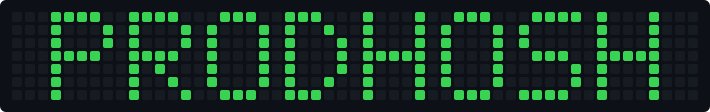
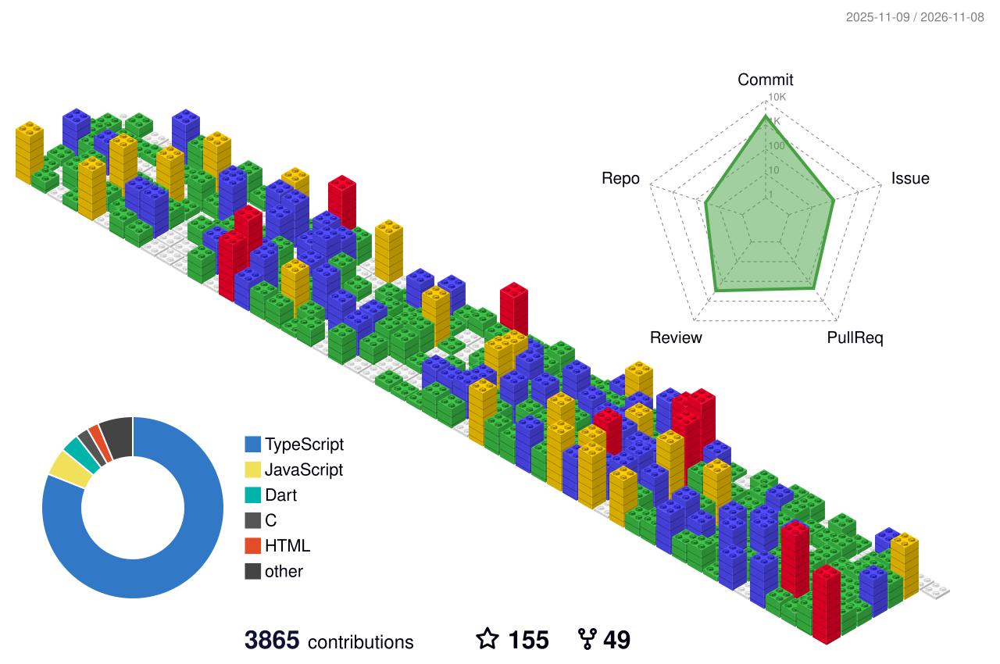
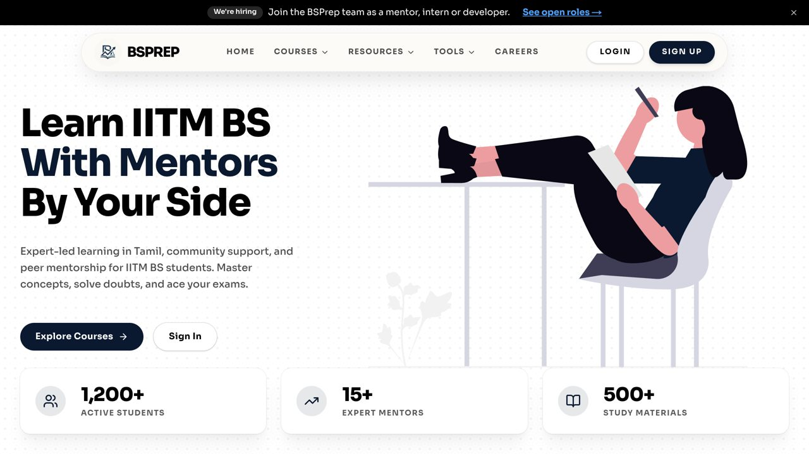
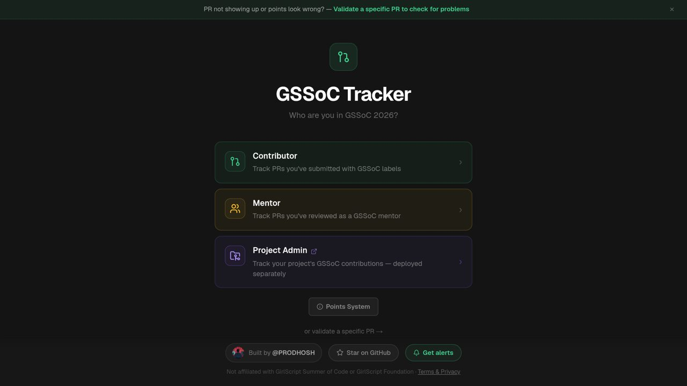
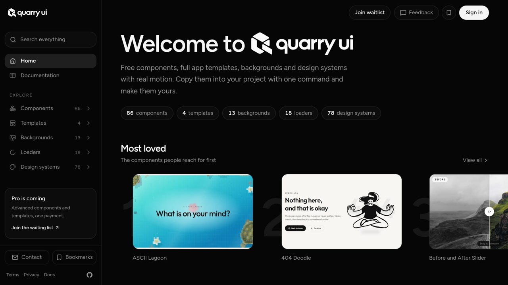

---

## whoami

---

## Contributions

---

## About

I'm Prodhosh, a CS sophomore at VIT Chennai, doing a BS in Data Science at IIT Madras alongside it. I'm the CTO at [Annexra](https://annexra.com), where I own architecture, delivery and engineering quality for a company building websites, automations and ERP systems for businesses.

I like building software that people actually use. I'm comfortable on both sides of the screen, the interface and the backend behind it.

Right now I'm focused on agentic AI, fintech and system design. I want to learn how software behaves when real people and real money depend on it.

If you're building something interesting, looking for a collaborator, or looking to hire, feel free to reach out at [hello@prodhosh.me](mailto:hello@prodhosh.me).

<pre>
██████╗ ██████╗  ██████╗ ██████╗ ██╗  ██╗ ██████╗ ███████╗██╗  ██╗
██╔══██╗██╔══██╗██╔═══██╗██╔══██╗██║  ██║██╔═══██╗██╔════╝██║  ██║
██████╔╝██████╔╝██║   ██║██║  ██║███████║██║   ██║███████╗███████║
██╔═══╝ ██╔══██╗██║   ██║██║  ██║██╔══██║██║   ██║╚════██║██╔══██║
██║     ██║  ██║╚██████╔╝██████╔╝██║  ██║╚██████╔╝███████║██║  ██║
╚═╝     ╚═╝  ╚═╝ ╚═════╝ ╚═════╝ ╚═╝  ╚═╝ ╚═════╝ ╚══════╝╚═╝  ╚═╝
</pre>

---

## What's in the toolbox

Grouped by what I use them for. I also work with TypeScript, Java, Hono, shadcn/ui, Framer Motion, React Native, FAISS, Razorpay and Resend.

<table>
<tr><td><b>Languages</b></td><td>     </td></tr>
<tr><td><b>Frontend</b></td><td> </td></tr>
<tr><td><b>Data and ML</b></td><td>    </td></tr>
<tr><td><b>Databases</b></td><td>   </td></tr>
<tr><td><b>Cloud and hosting</b></td><td>         </td></tr>
<tr><td><b>DevOps and automation</b></td><td> </td></tr>
</table>

---

## Experience

| Role | Company | When | What I did |
| --- | --- | --- | --- |
| Chief Technology Officer | [Annexra](https://annexra.in) | Aug 2026 to now | Promoted to CTO within 2 months. Built a D2C e-commerce platform (OTP login, Razorpay checkout, GST-aware pricing, server-side price checks) and an internal ERP with custom roles and PostgreSQL Row Level Security. |
| Full-Stack Developer Intern | [Midgreen](https://midgreen.in) | Sep 2026 to now | Wrote a deterministic search and matching engine for sustainable packaging that ranks 25 materials on 7 weighted factors. Built the public site and admin panel with 83 automated tests. |
| Next.js Developer Intern | [Sindra](https://sindra.tech) | Jul to Sep 2026 | Built Sindra Internal OS, one workspace for tasks, CRM, chat, calendar and documents, with role-based access and a custom email system. |

---

## Featured projects

<table>
<tr>
<td width="50%" valign="top">

### BS Prep

Exam prep platform for IIT Madras BS students. Tamil video courses, live classes, quizzes, GPA tools, an in-browser compiler and an AI doubt assistant. I lead engineering and shipped 4 products on one stack. 500+ daily active users.

`Next.js` `TypeScript` `Supabase` `Razorpay`

[Website](https://bsprep.in) | [GitHub](https://github.com/PRODHOSH/bs-prep)

</td>
<td width="50%" valign="top">

### GSSoC Tracker

A faster alternative to the official GSSoC 2026 leaderboard, with PR scoring, rankings, analytics and email alerts. 3,000+ users, 150,000+ contribution events and 100+ stars.

`Next.js` `TypeScript` `GitHub API` `PostgreSQL`

[Website](https://gssoc-tracker.vercel.app) | [GitHub](https://github.com/PRODHOSH/gssoc-tracker)

</td>
</tr>
<tr>
<td width="50%" valign="top">

### Quarry UI

Open-source library of 86 animated React components, 4 app templates, 13 live backgrounds, 18 loaders and 78 design-system briefs. Install anything with one shadcn CLI command.

`React` `TypeScript` `Tailwind CSS` `Framer Motion`

[Website](https://quarry-ui.vercel.app) | [GitHub](https://github.com/PRODHOSH/quarry-ui)

</td>
<td width="50%" valign="top">

### More on the way

More work lives on my portfolio, including Annexra, EcoLens, Kivo and OSSConnect.

[See everything at prodhosh.me](https://prodhosh.me)

</td>
</tr>
</table>

---

## Achievements

| Award | Where |
| --- | --- |
| Winner | Cloudinary May Mini Hack 2026, with EcoLens |
| 2nd place | ELUSOC 2026, among 13,000+ contributors, as Project Admin of OSSfolio |
| Rank 932 of 56,000 | GSSoC 2026 as Campus Ambassador, 97 merged PRs across 20 repos |
| 3rd prize | GadgetXpo Paradox '26, IIT Madras, for a BB84 quantum key distribution simulation |

**Certifications:** AWS Certified Cloud Practitioner, Cloudinary Media Developer Master, Claude Code 101 (Anthropic), Supervised Machine Learning (DeepLearning.AI).

---

## By the numbers

A quick scoreboard of my GitHub account. These update on their own, so the numbers are always current.

---

## Badges

A few digital badges I've picked up from communities and events along the way. Click through to see the full collection.

---

## Work with me

I'm open to freelance work and SDE roles.

| What | Details |
| --- | --- |
| Freelance | Web apps, software products and internal tools for businesses |
| Full-time | SDE roles, especially around agentic AI, fintech and backend systems |
| Currently exploring | Agentic AI, fintech, system design |
| Best way to reach me | [hello@prodhosh.me](mailto:hello@prodhosh.me) |

---

## Connect

---

## Leave a message

If you have something to say, a question, feedback, or just want to say hi, open a thread in [Discussions](https://github.com/PRODHOSH/PRODHOSH/discussions). I read every one of them.

<picture>
  <source media="(prefers-color-scheme: dark)" srcset="https://raw.githubusercontent.com/platane/snk/output/github-contribution-grid-snake-dark.svg">
  <source media="(prefers-color-scheme: light)" srcset="https://raw.githubusercontent.com/platane/snk/output/github-contribution-grid-snake.svg">
  
</picture>

---

Thanks for visiting. Feel free to say hi.

