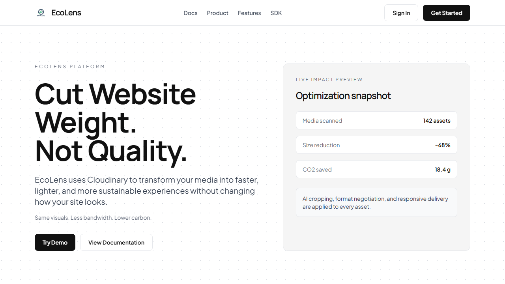

<h3>CTO at Annexra. I build products that people use every day.</h3>

---

## About

### The Blueprint.

I'm Prodhosh. I learn something new every single day, and I genuinely enjoy it. I like working with people, figuring things out together and shipping work I'm proud of.

I've freelanced with a bunch of companies and startups, building software solutions, automations, full software systems and websites. Today I'm the CTO at [Annexra](https://annexra.in), where I own the architecture, delivery and engineering quality for everything we build.

I'm a CS sophomore at VIT Chennai, doing a BS in Data Science at IIT Madras alongside it.

- **Right now:** CTO at Annexra, full-stack intern at Midgreen
- **Learning:** agentic AI, fintech, system design and how software behaves when real people and real money depend on it
- **Leveling up in cloud:** AWS, every day
- **Open to:** freelance projects and SDE roles

---

## Featured projects

<table>
<tr>
<td width="50%" valign="top">

### BS Prep

Exam prep platform for IIT Madras BS students. Tamil video courses, live classes, quizzes, GPA tools, an in-browser compiler and an AI doubt assistant. I lead engineering and shipped 4 products on one stack. **500+ daily active users.**

`Next.js` `TypeScript` `Supabase` `Razorpay`

[Website](https://bsprep.in) | [GitHub](https://github.com/PRODHOSH/bs-prep)

</td>
<td width="50%" valign="top">

### GSSoC Tracker

A faster alternative to the official GSSoC 2026 leaderboard, with PR scoring, rankings, analytics and email alerts. **3,000+ users, 150,000+ contribution events and 100+ stars.**

`Next.js` `TypeScript` `GitHub API` `PostgreSQL`

[Website](https://gssoc-tracker.vercel.app) | [GitHub](https://github.com/PRODHOSH/gssoc-tracker)

</td>
</tr>
<tr>
<td width="50%" valign="top">

### EcoLens

**Winner of the Cloudinary May Mini Hack 2026.** Scans a website or repo for heavy images and video, then uses Cloudinary to make them lighter without changing how they look. Every scan reports the bandwidth and CO2 you saved.

`Next.js` `TypeScript` `Cloudinary`

[Website](https://ecolens-cloudinary.vercel.app) | [GitHub](https://github.com/PRODHOSH/ecolens-cloudinary)

</td>
<td width="50%" valign="top">

### Quarry UI

Open-source library of 86 animated React components, 4 app templates, 13 live backgrounds, 18 loaders and 78 design-system briefs. Install anything with one shadcn CLI command.

`React` `TypeScript` `Tailwind CSS` `Framer Motion`

[Website](https://quarry-ui.vercel.app) | [GitHub](https://github.com/PRODHOSH/quarry-ui)

</td>
</tr>
</table>

**Also built:** [Kivo](https://kivo.prodhosh.me), a voice assistant that runs your desktop on local AI. [Relay](https://relay.prodhosh.me), which makes LaTeX PDFs and sends bulk email from your own machine. [FlashFetch](https://flashfetch.vercel.app), document Q&A that cites its sources. [See all 17 projects on prodhosh.me](https://prodhosh.me).

---

## Experience

| Role | Company | When | What I did |
| --- | --- | --- | --- |
| Chief Technology Officer | [Annexra](https://annexra.in) | Aug 2026 to now | Promoted to CTO within 2 months. Built a D2C e-commerce platform (OTP login, Razorpay checkout, GST-aware pricing, server-side price checks) and an internal ERP with custom roles and PostgreSQL Row Level Security. |
| Full-Stack Developer Intern | [Midgreen](https://midgreen.in) | Sep 2026 to now | Wrote a deterministic search and matching engine for sustainable packaging that ranks 25 materials on 7 weighted factors. Built the public site and admin panel with 83 automated tests. |
| Next.js Developer Intern | [Sindra](https://sindra.tech) | Jul to Sep 2026 | Built Sindra Internal OS, one workspace for tasks, CRM, chat, calendar and documents, with role-based access and a custom email system. |

---

## Achievements

| Award | Where |
| --- | --- |
| Winner | Cloudinary May Mini Hack 2026, with EcoLens |
| 2nd place | ELUSOC 2026, among 13,000+ contributors, as Project Admin of OSSfolio |
| Rank 932 of 56,000 | GSSoC 2026 as Campus Ambassador, 97 merged PRs across 20 repos |
| 3rd prize | GadgetXpo Paradox '26, IIT Madras, for a BB84 quantum key distribution simulation |

**Certifications:** AWS Certified Cloud Practitioner, Cloudinary Media Developer Master, Claude Code 101 (Anthropic), Supervised Machine Learning (DeepLearning.AI).

---

## Tech I work with

<table>
<tr><td><b>Languages</b></td><td>       </td></tr>
<tr><td><b>Frontend</b></td><td>     </td></tr>
<tr><td><b>Backend</b></td><td>  </td></tr>
<tr><td><b>AI and automation</b></td><td>  </td></tr>
<tr><td><b>Data and ML</b></td><td>    </td></tr>
<tr><td><b>Databases</b></td><td>   </td></tr>
<tr><td><b>Payments and email</b></td><td> </td></tr>
<tr><td><b>Cloud and hosting</b></td><td>          </td></tr>
<tr><td><b>DevOps and tools</b></td><td>  </td></tr>
</table>

---

## Life on GitHub

Everything here updates on its own. The graph shows a year of contributions, and the koi is redrawn every night from what I shipped that day.

The koi is drawn by <a href="https://github.com/yalongwastaken/git-koi">git-koi</a>

  

---

## Latest from my blog

I write about building real products, open source and what I learn along the way.

<!-- BLOG-POST-LIST:START -->
- [Malware Hid in My Old Repos and Git Never Showed It](https://blog.prodhosh.me/blog/malware-hid-in-my-old-repos-polinrider)
- [hackerRank just open sourced their hiring agent. and it reveals way more than i expected.](https://blog.prodhosh.me/blog/hackerrank-just-open-sourced-their-hiring-agent-and-it-reveals-way-more-than-i-expected)
- [Why Image Uploads in Next.js Are More Complicated Than They Look](https://blog.prodhosh.me/blog/why-image-uploads-in-nextjs-are-more-complicated-than-they-look)
- [How to Build a GitHub Profile README That Actually Stands Out](https://blog.prodhosh.me/blog/how-to-build-a-github-profile-readme-that-actually-stands-out)
- [How I&#39;d Start Contributing to Open Source If I Were a Beginner in 2026](https://blog.prodhosh.me/blog/what-is-open-source-and-how-i-would-start-contributing-if-i-were-a-beginner-today)
<!-- BLOG-POST-LIST:END -->

[Read more on blog.prodhosh.me](https://blog.prodhosh.me)

---

## Work with me

| What | Details |
| --- | --- |
| Freelance | Web apps, software products and internal tools for businesses |
| Full-time | SDE roles, especially around agentic AI, fintech and backend systems |
| Reach me | [hello@prodhosh.me](mailto:hello@prodhosh.me) |

Got a question, some feedback, or just want to say hi? Open a thread in [Discussions](https://github.com/PRODHOSH/PRODHOSH/discussions). I read every one.

 

<h3>This is me at 2am, shipping something. Come say hi.</h3>

 

Thanks for stopping by.

